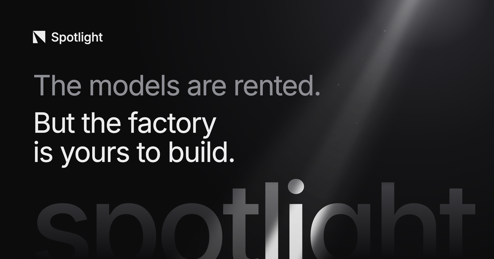

  <h3>
    <a href="https://app.usespotlight.ai"><strong>Spotlight Cloud</strong></a> ·
    <a href="https://docs.usespotlight.ai"><strong>Docs</strong></a> ·
    <a href="https://docs.usespotlight.ai/docs/getting-started/start-guide"><strong>Getting Started</strong></a>
  </h3>

  <a href="https://github.com/usespotlightai/spotlight/issues/new?labels=bug"><strong>Report Bug</strong></a> ·
  <a href="https://github.com/usespotlightai/spotlight/discussions/new?category=ideas"><strong>Feature Request</strong></a> ·
  <a href="https://github.com/usespotlightai/spotlight/releases"><strong>Changelog</strong></a> ·
  <a href="https://docs.usespotlight.ai/docs/reference/roadmap"><strong>Roadmap</strong></a>

 

  
  
  
  
  

Spotlight is an open-source platform for running your team's process as a line of stations. Agents work on tasks, people handle questions and approvals in the inbox, and run results help you evaluate changes to the process.

## Core Features

- **Give agent handoffs clear rules.** Build a line with stations such as Triage, Spec and Build. Configure each work station's agent with its own prompt, tools, skills and model. An agent can pass a task along an allowed route, request review in the inbox, or finish the task at the end of the line.
- **Unblock agents when they need a person.** Plan work with your team's agent in chat. You accept its proposed tasks before they start. Agents can ask questions, and tool calls that require approval wait for a decision in the inbox. Answer in Spotlight, or in Slack or any other messaging app through an integration.
- **Avoid tying your process to one harness.** Run Claude Code, Codex, Cursor or OpenCode. Choose the model and effort per station. Define permissions and MCP servers in a shared harness profile. Spotlight translates the profile into each harness's native settings.
- **Control where agent code runs.** Run agents in sandboxes on your infrastructure or in Spotlight Cloud. Install the `spotlight` host on a machine with Docker or Podman, or bring your own sandbox provider. Use images with your toolchain and dependencies installed. A task's workspace carries across runs, and a sandbox can stay alive for later runs.
- **Keep secrets out of the agent's reach.** Secrets never enter the sandbox. Each run's egress proxy injects them into outgoing requests, and only for the hosts each secret is bound to. Store secrets in your workspace's vault or AWS Secrets Manager.
- **Keep people up to speed on agent code.** Spotlight can split changes into reviewable layers and record the agent's decisions and reasons. Check your understanding with optional layer questions. Answer in your own words or say you don't know, then see the expected answer. Spotlight grades your answers and gives feedback. It can also review your team's GitHub pull requests when asked.
- **Make agent configuration reviewable.** Define lines and their stations, teams, integrations and harness profiles in Terraform. Review configuration changes in pull requests alongside your code. A setup chat drafts your team's initial configuration and opens a pull request.
- **Check whether a configuration change helps.** Insights connect station configuration changes to run results, rework and cost. Replay a change on past tasks and evaluate it with the station's configured checks and judge. Spotlight can also search for better configurations, test candidates on tasks held out of the search, and open a pull request for the candidate you choose.

## Contributing

Your contributions are welcome!

- Vote on ideas in [GitHub Discussions](https://github.com/usespotlightai/spotlight/discussions).
- Raise and comment on [Issues](https://github.com/usespotlightai/spotlight/issues).
- Open a pull request. See [CONTRIBUTING.md](CONTRIBUTING.md) for how to set up a development environment.

## License

Spotlight is licensed under the [Apache License 2.0](LICENSE).
