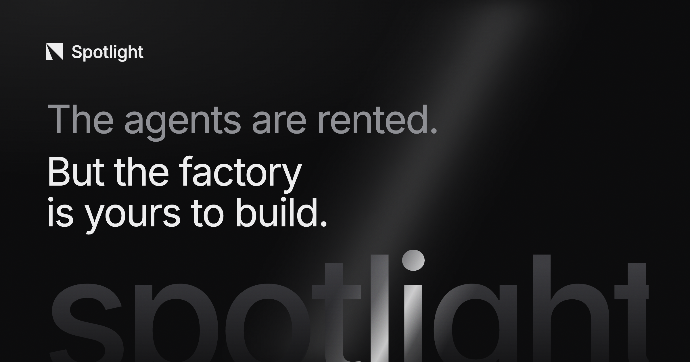

  <h3>
    <a href="https://usespotlight.ai"><strong>Website</strong></a> ·
    <a href="https://app.usespotlight.ai"><strong>Sign in</strong></a> ·
    <a href="CONTRIBUTING.md"><strong>Contributing</strong></a>
  </h3>

Spotlight turns your team's process into a line of stations, each run by its own agent. Tasks move from station to station, people step in where a decision is theirs, and every change to how the line works is measured against the runs it affects.

## ✨ Core Features

- **A line of stations.** Each station runs its own agent, prompt, tools and model. Agents ask before they guess, and nothing starts until a person accepts the work.
- **Any harness, any model.** Claude Code, Codex or Cursor, chosen per station.
- **Runs on your machines.** Every run gets a fresh sandbox on your servers, in Daytona or E2B, or in our cloud.
- **Secrets stay out of the agent.** They are added to requests only as they leave the sandbox.
- **Configuration as code.** Lines, stations and teams are Terraform, reviewed in pull requests.
- **Measured, then improved.** Replay a config change on past tasks before it ships, or let Spotlight search for a better one.

## 🤝 Contributing

Your contributions are welcome!

- Vote on ideas in [GitHub Discussions](https://github.com/usespotlightai/spotlight/discussions).
- Raise and comment on [Issues](https://github.com/usespotlightai/spotlight/issues).
- Open a pull request. See [CONTRIBUTING.md](CONTRIBUTING.md) for how to set up a development environment.

## 🥇 License

Spotlight is licensed under the [Apache License 2.0](LICENSE).
